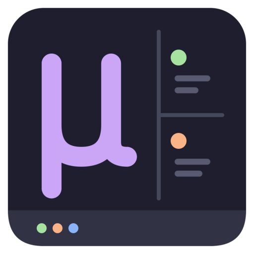

<p align="center">
  
</p>

<h1 align="center">mu-crew</h1>

<p align="center">
Run a crew of coding agents in <a href="https://github.com/martintrojer/vtmux">tmux</a>: Claude Code, Codex, Cursor, Muse Code and <a href="https://github.com/earendil-works/pi">pi</a>, mixed as you like.<br>
See which one needs you, on any machine.<br>
Keep long jobs off your SSH session.<br>
Keep the crew's builds from eating the machine.<br>
Keep every session they ever ran.
</p>

## The tools

| Tool | What it does |
| --- | --- |
| [**mu**](https://github.com/mu-crew/mu) | Plans the work and hands it out: task DAG, per-agent workspaces, audit log |
| [**murmur**](https://github.com/mu-crew/murmur) | Shows which agent, on which host, is waiting on you, and jumps you there |
| [**mule**](https://github.com/mu-crew/mule) | Runs the long build on a remote host without holding your SSH session |
| [**muzzle**](https://github.com/mu-crew/muzzle) | Queues heavy commands from all your agents on each machine, and sizes them from what they really used |
| [**museum**](https://github.com/mu-crew/museum) | Backs up your agents' sessions (pi, Claude Code, Codex, cursor-agent) from every machine to one store your agents can search |
| [**tsesh**](https://github.com/mu-crew/tmux-session-picker) | Picks or creates a tmux session, with each session's agent state |
| [**dotfiles**](https://github.com/mu-crew/dotfiles) | Wires them into tmux: agent state in tabs and borders, a status pill, keys |

```sh
npm i -g \
  @mu-crew/mu \
  @mu-crew/murmur \
  @mu-crew/mule \
  @mu-crew/muzzle \
  @mu-crew/museum
murmur init                      # this node's identity, and murmur's hook entries
mu init                          # mu's Stop hook entry and skill per harness
muzzle init                      # muzzle's hook entries: queues heavy shell calls
museum init devbox:/data/museum  # museum's store, hook entries, skill and sync timer
pi install npm:@mu-crew/mu       # pi: mu's extension, skill and recipe prompts
pi install npm:@mu-crew/murmur   # pi: murmur's extension (state across machines, tmux badges)
pi install npm:@mu-crew/muzzle   # pi: muzzle's extension and skill
pi install npm:@mu-crew/museum   # pi: museum's extension and skill
```

Each `init` writes entries for every harness set up on the machine (Claude Code,
Codex, Cursor, Muse Code) and touches only its own. The `pi install` lines are
for pi. `museum init` takes the store (`host:/path`, or a local `/path`).
Update everything with `npm update -g`, rerun the `init`s, and
`pi update --extensions`.

Each tool works alone. Start with mu: it plans the work and hands it to agents
of any of the five, locally and on remote hosts. It drives pi exactly through a
control socket, and the other four by paste, confirmed by their own hook events
through murmur. Add murmur for the cross-machine "who needs me" view, tmux
badges and jump. Add mule when a remote host caps SSH sessions or a command
must survive a dropped connection. Add muzzle when several agents' builds and
tests share one machine. Add museum when your sessions are worth keeping.

## How they fit

The tools share no code and no database. They meet in environment variables
and tmux options:

- mu sets `MU_AGENT_NAME` and `MU_WORKSTREAM` in every pane it spawns. murmur
  marks those agents as crew and shows them only when they need you.
- mu's pi extension serves a per-agent control socket at a path mu derives
  from workstream and agent (`MU_CTL_SOCK`); murmur's extension publishes
  `@murmur_*` tmux options. Both load in the same pi and do not depend on each
  other.
- Claude Code, Codex, Cursor and Muse Code run `murmur hook <harness>` from
  their own hooks. Each call drops one event file, and murmur's readers turn
  the files into state. mu reads that state to confirm a send and to see a turn
  end, with its final text.
- mule runs each job as `mule-<id>`, so a remote job shows up in murmur too.
- museum copies each machine's pi, Claude Code, Codex and cursor-agent session
  files into its own folder in one store, over plain rsync, started by a pi
  extension, a tmux status line or a timer. Agents read the store with a skill,
  and `museum status` shows which museum version each machine runs.
- muzzle needs nothing from mu, but uses what mu sets. A build you start in
  your own shell goes ahead of builds queued by mu's workers, and
  `muzzle status` shows which agent holds each slot.
- murmur publishes agent state as `@murmur_*` tmux options. The dotfiles and
  tsesh read them, and so can anything else.

## What we believe

- **Stay out of the model's way.** The tools coordinate; the model decides.
- **No daemons, no complicated setup.** State is SQLite and files on each machine.
- **Standalone tools that compose.** Each is useful alone.

Built on tmux, with five first-class agent CLIs (pi has the exact channel)
and narrower support for herdr, Rex and opencode. The full stance is in
[STANCE.md](https://github.com/mu-crew/.github/blob/main/STANCE.md)
and the design rules in [ZEN.md](https://github.com/mu-crew/.github/blob/main/ZEN.md).

## Built by agents, for agents

AI coding agents wrote most of this code, running on this stack, with a human
reviewing what ships. The CLIs print next steps and use distinct exit codes so
an agent can drive them too.

Published as-is. Issues are welcome; open one before a pull request.
